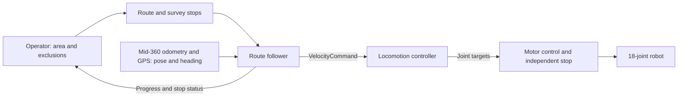

# Hexapod architecture

We are building a robot that follows an approved route through a survey area
and stops with a steady payload deck at each survey point. The operator defines
the area and exclusions on an open map. The robot locates itself with a Livox
Mid-360 and onboard GPS, and a learned controller moves its 18 joints.

This guide defines the system boundaries and integration requirements. Each
decision has one owner file; this guide cites those files and does not restate
their values. Use [TRAINING](docs/TRAINING.md) for locomotion goals and
acceptance, and the
[progress site](https://cornell-physical-intelligence.github.io/hexapod-cupi/)
for demonstrated results. Track assignments in GitHub issues.

## Owner files

The program lead decides the content of the first four files. Contributors edit
`site/project.json` for progress, and a step becomes done only with a named
acceptance. To change a decision, change its file. The last column names what
reads each file; review covers a field that no check reads, such as
`pose_source`.

| File | Decides | Read by |
| --- | --- | --- |
| [`robot/active_model.json`](robot/active_model.json) | The approved robot model and its motor corrections, with the hash of each model file. | `tools/check_pipeline_lineages.py current` binds the URDF, model and USD hashes. |
| [`configs/walking_requirements.json`](configs/walking_requirements.json) | What the survey asks of the walking controller: the commands navigation may send, the hold times, the stop tolerance and routes, the tilt and motor torque limits, the pose source and the payload. | `src/navigation/tests/test_requirements.py` binds the commands to the follower; [the judge](src/locomotion/evaluation/requirements.py) reads the cases and limits. |
| [`configs/accepted_controller.json`](configs/accepted_controller.json) | The one checkpoint the project calls its walking controller, the requirement set it claims, each judged row with its evidence, and what nobody has judged yet. | `tests/test_accepted_controller.py` binds the hashes, limits and judged values to their sources. |
| [`configs/approved_code_version.json`](configs/approved_code_version.json) | The code version approved to run native evaluations of the accepted controller, and the receipt that binds its runtime files. | `tests/test_approved_code_version.py` binds the receipt; `tools/project_site.py check` reports a lapsed approval and does not fail on it. |
| [`site/project.json`](site/project.json) | The roadmap: the state of each step, its owner file and what done means. | `tools/project_site.py check` refuses a done step that its rules do not admit. |

## Target system

The diagram shows the intended system. In simulation we train and evaluate the
controller, and the waypoint follower drives the accepted controller along the
routes of the walking requirements. A grid route planner finds a route between
two cells of a drawn region. The pose estimate, the chain of routes through the
survey stops, the mission controls and the hardware control runtime remain
open. The physical robot still needs assembly and qualification.

## Code boundaries

| Package | Responsibility |
| --- | --- |
| [`robot/`](robot/active_model.json) | Select the approved model and its motor corrections. Keep model identity with simulation inputs and results. |
| [`src/locomotion/`](src/locomotion/README.md) | Train and evaluate the walking controller. Keep the omniwalk and hexapod experiments separate; share evaluation tools and motion-prior data. |
| [`src/contracts/`](src/contracts/README.md) | Define shared velocity commands and planar poses without simulator dependencies. Retain checkpoint identity checks. |
| [`src/navigation/`](src/navigation/README.md) | Plan routes and turn poses into the commands of the walking requirements. It holds a waypoint follower and a grid route planner. |
| [`src/mission/`](src/mission/README.md) | Future operator controls and mission execution. Its Mid-360 ray-pattern and transport prototypes have no navigation role yet. |
| `viewer/` and `site/` | Inspect the model and publish progress. Keep these tools outside robot control. |

Navigation and mission code use the shared contracts and must not import
locomotion. Keep planning and network access outside the control loop. A
simulator backend belongs behind the locomotion interface; its choice must
not dictate the route follower or mission API.

GeoData owns survey data acquisition and export. Agree on pose and stop-status
exchange with the payload team before integrating survey execution.

## Navigation and commands

`pose_source` in the walking requirements names the pose source: Mid-360
lidar-inertial odometry gives local position and heading, and GPS without RTK
corrections places the route in the global frame. Define one local east-north
frame, the map frame, for the map, route and pose. In the map frame, `Pose2D`
+x is east and +y is north; a pose adapter must convert its heading to this
convention (e.g. a compass bearing, which runs clockwise from north). Account
for position and heading uncertainty when setting boundaries and stopping
margins. Use a reviewed, obstacle-free course for the first survey; an open map
cannot establish that the walking path is clear. The Mid-360 is the
localization sensor; the baseline has no ground map or obstacle detector.

`VelocityCommand` carries forward and lateral speed in m/s and yaw rate in
rad/s. Anatomical forward is body -Y, left is body +X, and up is body +Z.
`Pose2D` carries position and heading; the current type has no timestamp or
uncertainty fields. Extend the contract before using it as a live pose
interface.

Navigation sends only the `commands` of a requirement set in the walking
requirements, and `src/navigation/tests/test_requirements.py` fails when the
follower's command bank and the file differ. A command producer may supply a
narrower envelope. The accepted controller is judged only on the set it claims,
so a wider envelope needs a new requirement set and a new judgement first.

## Integration requirements

You operate one robot under one operator's authority. Support start, pause,
resume and abort, with an independent hardware emergency stop. Expired commands
or critical sensing failure must stop execution. Define command validity and
the handling of a lost Mid-360 pose or GPS fix before connecting the navigation
loop to hardware.

Keep the full moving footprint within the approved area, including position
error and stopping distance. Report reached and unreached stops with a reason.
The walking requirements set the stop tolerance, the settle time and the tilt
limit at a stop. Agree on any further payload stability requirement with the
payload team before survey acceptance.

Use the approved model in `robot/active_model.json` and the controller in
`configs/accepted_controller.json`; a candidate becomes the controller only by
replacing that file. Run native evaluations on the code version that
`configs/approved_code_version.json` approves. A changed runtime file lapses
that approval until a new campaign writes a new receipt. Validate actuator
behavior on the [single-leg stand](docs/LEG_STAND_HARDWARE.md), then verify
joint mapping and full-body behavior on hardware. Preserve the limits in the
walking requirements and the comparison limiter in
[CONTRIBUTING](CONTRIBUTING.md#results-and-publication); simulation evidence
alone cannot qualify a hardware release. Bind each release to its model,
source, configuration and checkpoint.

Use [CONTRIBUTING](CONTRIBUTING.md) for changes and [SPARK](SPARK.md) for compute
access. The package guides describe implementation details.
