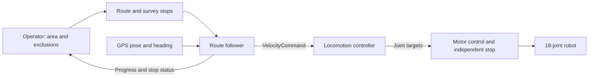

# Hexapod architecture

We are building a robot that follows an approved route through a survey area
and stops with a steady payload deck at each survey point. The operator defines
the area and exclusions on an open map. The robot uses onboard GPS to locate
itself and a learned controller to move its 18 joints.

This guide defines the system boundaries and integration requirements. Use
[TRAINING](docs/TRAINING.md) for locomotion goals and acceptance, and the
[progress site](https://cornell-physical-intelligence.github.io/hexapod-cupi/)
for demonstrated results. Track assignments in GitHub issues.

## Target system

The diagram shows the intended system. We have a waypoint follower example and
simulation training/evaluation. Route planning and GPS integration remain open,
as does the hardware control runtime. The physical robot still needs assembly
and qualification.

## Code boundaries

| Package | Responsibility |
| --- | --- |
| [`robot/`](robot/active_model.json) | Select the approved model and its motor corrections. Keep model identity with simulation inputs and results. |
| [`src/locomotion/`](src/locomotion/README.md) | Train and evaluate the walking controller. Keep the omniwalk and hexapod experiments separate; share evaluation tools and motion-prior data. |
| [`src/contracts/`](src/contracts/README.md) | Define shared velocity commands and planar poses without simulator dependencies. Retain checkpoint identity checks. |
| [`src/navigation/`](src/navigation/README.md) | Plan routes and turn poses into bounded velocity commands. The current implementation is a waypoint follower example. |
| [`src/mission/`](src/mission/README.md) | Future operator controls and mission execution. Existing sensor prototypes remain separate from GPS navigation. |
| `viewer/` and `site/` | Inspect the model and publish progress. Keep these tools outside robot control. |

Navigation and mission code use the shared contracts and must not import
locomotion. Keep planning and network access outside the control loop. A
simulator backend belongs behind the locomotion interface; its choice must
not dictate the route follower or mission API.

GeoData owns survey data acquisition and export. Agree on pose and stop-status
exchange with the payload team before integrating survey execution.

## Navigation and commands

The baseline uses onboard GPS without RTK corrections. Define one local
east-north frame for the map, route and pose. Account for position and heading
uncertainty when setting boundaries and stopping margins. Use a reviewed,
obstacle-free course for the first survey; an open map cannot establish that
the walking path is clear. The baseline has no ground map or obstacle detector.

`VelocityCommand` carries forward and lateral speed in m/s and yaw rate in
rad/s. Anatomical forward is body -Y, left is body +X, and up is body +Z.
`Pose2D` carries position and heading; the current type has no timestamp or
uncertainty fields. Extend the contract before using it as a live GPS interface.

The command producer supplies an explicit allowed envelope. Match that envelope
to the controller's demonstrated range; the waypoint example's defaults do
not qualify a walking policy.

## Integration requirements

You operate one robot under one operator's authority. Support start, pause,
resume and abort, with an independent hardware emergency stop. Expired commands
or critical sensing failure must stop execution. Define command validity and
GPS failure handling before connecting the navigation loop to hardware.

Keep the full moving footprint within the approved area, including position
error and stopping distance. Report reached and unreached stops with a reason.
Agree on payload stability and settling requirements before survey acceptance.

Use the approved model in `robot/active_model.json`. Validate actuator behavior
on the [single-leg stand](docs/LEG_STAND_HARDWARE.md), then verify joint mapping
and full-body behavior on hardware. Preserve the comparison limiter and gates
in TRAINING; simulation evidence alone cannot qualify a hardware release.
Bind each release to its model, source, configuration and checkpoint.

Use [CONTRIBUTING](CONTRIBUTING.md) for changes and [SPARK](SPARK.md) for compute
access. The package guides describe implementation details.
